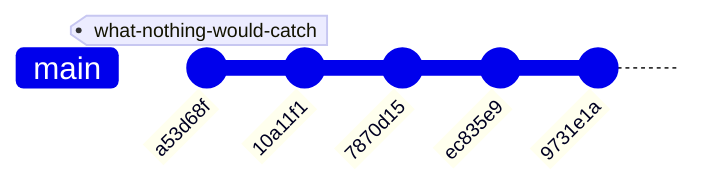
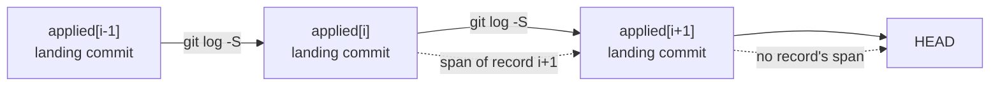

# Commit attribution — design document

**Status**: second draft. Nothing built, nothing specced. A review returned two MAJOR and three MINOR findings. Every §4 number reproduced, but 25 of the 49 records turned out to land in two shared commits, and the contract already carried an assumption this design contradicts; both are now in the text. It extends
`plans/design-the-loop.md`, which closes the handoffs *between* lanes; this one asks a
different question — whether any lane ran at all before the code landed.
· **Date**: 2026-09-14
· **Contract at**: 0.16.3
**Evidence base**: measured in this checkout at `9731e1a` on 2026-09-14, with the command
that produced each figure given beside it. One figure in §4.2 was wrong on first
measurement and §4.2 says how.

---

## 1. What this document is

A design for answering one question mechanically: **which record authorised this commit?**

flw records what was decided and never records that anything happened. A version record
says what a version changes. The contract's `applied` list says it landed. Neither says
*where* it landed, and a record carries no date, no author and no revision. Its `base`
field orders records against each other, but nothing gives a time. Its ten
schema keys are `approach, base, contract_edit, dag, decisions, name, release_line,
sources, spec_version, summary`.

So every question of the form *did this work follow the process* needs a human reading
records against `git log` with judgment. flw's own `the-lanes` review hit that wall and
filed it under what it did not check: *"Whether any commit in the last 40 was made without
a version record covering it. Attributing a commit to a record needs judgment against each
record's `dag` and `summary`, and I did not do it."*

This document shows the attribution is not a matter of judgment. It is already in git, it
costs one command, and nothing has to be declared, stamped or remembered to get it.

This is not a spec. It says what the thing is, what it refuses to be, and what is still
open. `flw-spec` turns it into a contract amendment afterwards.

## 2. The problem

`flw-execute` step 1 says:

> **Record where the run starts.** Before writing anything, capture the current commit —
> `git rev-parse HEAD` … You cannot recover it afterwards, and step 5 needs it to show what
> the run changed.

Step 6 uses that value for the run's diff. Then the run ends and the value is gone. It is
the one number that would make every commit in the repository attributable, it is computed
on every run already, and nothing writes it down.

The consequence is visible in this repository right now. §4.2 measures it: three of the
four commits since the last applied record change paths a component owns, two of them
shipped instruction files read by every session on this machine, and no record names any
of them. Nothing reported that, because nothing looks.

## 3. What this is not

**Not a hook layer.** flw does not intercept commits and this does not either. Every check
here is a subcommand someone runs or a check a project declared.

**Not a rule that every commit needs a record.** flw's own posture is that it is *"a way to
agree, not a tax on every edit"*. §5.4 is the exclusion that keeps this true, and §6 is
what the design deliberately cannot see.

**Not lane-order enforcement.** Two of the four lanes leave nothing behind that survives a
clone. §4.3 measures it and §6 says what follows.

**Not a new field, a new store or a new schema key.** The whole mechanism is a derivation
over files already tracked.

**Not free of a contract change, though.** `specs/current.toml:58` has been an assumption
since the first commit: *"flw proposes commits but does not make them, and reads no VCS state
except to locate a project root when nothing nearer is found."* Reading `git log` over the
history contradicts it. The knowledge store's `numstat` already does too, and so does the
contract's own knowledge-store property, "Staleness is a git diff", so the assumption is
stale before this document touches it. But this design goes further than a working-tree
diff, and the record that builds it amends the assumption rather than leaning on the
precedent.

## 4. Measured

### 4.1 The keystone is already in git, 49 times out of 49

When `flw-execute` finishes, it appends the record's name to `applied` in
`specs/current.toml`. That edit lands in a commit. `git log -S` finds it:

```sh
git log --format=%H -S '"<record name>"' -- specs/current.toml
```

Run over all 49 applied names:

```text
applied: 49  | one commit: 49  | several: 0  | none: 0

mark-what-is-spent          b3fa4d5  2026-09-04
resolve-before-comparing    f495f6d  2026-09-04
say-what-was-not-read       45b604f  2026-09-04
nothing-falls-through       dda6f87  2026-09-04
a-shape-is-not-a-judgment   86866fb  2026-09-04
what-nothing-would-catch    a53d68f  2026-09-04
```

**Every name resolves to exactly one commit. None is ambiguous and none is missing.** So
each record owns the half-open range from the previous record's landing commit to its own,
and the ranges tile the history without gaps or overlaps by construction.

**The 49 names land in only 26 distinct commits.** Twenty land at `a030fd4`, "add flw: a
host-agnostic spec-driven workflow", the repository's first commit, which imported records
written before this repository existed. Five more land together at `0eb58f2`, "record five
versions and move the contract to 0.11.5". A landing commit shared by several names gives
every name after the first an empty span, so 25 of the 49 spans are empty and say nothing
about how the work was committed. The 24 records with a landing commit of their own are
the population the rest of this section measures.

Span sizes over the last eight records — 1 to 6 commits — are what a coherent run looks
like:

```text
checked-and-bounded        4      say-what-was-not-read       3
no-false-premises          6      nothing-falls-through       6
mark-what-is-spent         5      a-shape-is-not-a-judgment   4
resolve-before-comparing   1      what-nothing-would-catch    3
```



The tag is the landing commit of the last applied record. Everything after it is in no
record's span.

### 4.2 Three of the four commits since the last record are authorised by none

`what-nothing-would-catch` landed at `a53d68f` on 2026-09-04. Since then:

| commit | subject | component it changes |
|---|---|---|
| `9731e1a` | give the wrap rule one line per destination | the skills |
| `ec835e9` | add the design for closing flw's own loop | the project surface |
| `7870d15` | say what shape the mark on a spent report has to be | the skills |
| `10a11f1` | add the fresh-code review team | none — `.flw/` is in no component |

Two of these change `core/skills/` and `core/styles/` — files `flw install` and
`flw style install` push into every host on the machine, so a wrong line in one is a wrong
instruction to every later session in every repository. Neither went through `flw-spec`.
Both were made in the session that wrote this document.

**A correction, because it bears on how much this measurement can be trusted.** The first
run of this reported all four as touching no component path. The matcher read a top-level
`components` key; the contract holds them at `final_state.components`, so every lookup
returned nothing and the filter produced plausible rows saying the opposite of the truth.
That is the failure mode this whole design is about — nothing was wrong on the surface, and
only re-reading the contract's own shape exposed it.

### 4.3 Two of the four lanes leave no tracked trace

What survives a clone, from `.gitignore` and `git check-ignore`:

| artifact | lane that writes it | tracked |
|---|---|---|
| `specs/versions/` | flw-spec | yes |
| `specs/current.toml` `applied` | flw-execute | yes |
| `.flw/config.toml` | flw-research | yes |
| `.flw/extensions/` | flw-research | yes |
| `.flw/reviews/` | the user | yes |
| `.flw/knowledge/` | flw-research, corrected by all four | **no** |
| `.flw/reports/` | flw-review | **no** |

`flw-spec` and `flw-execute` leave durable evidence. `flw-research` leaves half — its
config and extensions are tracked, its knowledge store is not. **`flw-review` leaves
nothing at all.** The only tracked evidence that a review ever happened is a record's
`sources` field, which 3 of 58 records carry.

### 4.4 Twenty-three of twenty-four records entered git in the commit that applied them

The record file itself gives a second, independent derivation — `git log --diff-filter=A --
specs/versions/<name>-*.toml` finds the commit that added it. Comparing that against the
landing commit from §4.1 says whether the agreement was in the repository before the work
finished:

```text
applied 49  | record added in the SAME commit that applied it: 48
record added BEFORE its landing: 1   after: 0   unresolved: 0

a-rule-nothing-breaks    4 commits apart
```

Across all 49 names the figure is 48, but 25 of those are the two shared landings from §4.1:
an import and a batch, where "same commit" is true and meaningless. Over the 24 records that
landed in their own commit, it is **23 same, 1 before**.

**One record out of twenty-four is visible in git as something agreed before it was built.**
For the other twenty-three, the record, the work and the contract move arrive together, so
the repository cannot distinguish a plan that governed the build from a write-up composed
after it.

**This is not misuse — it is what `commits.md` asks for.** Its own rule: *"It carries
everything that changed for that part: the code, the check that proves it, the prose that
describes it, the contract sentence that claims it. Not the fix in one commit and its test
in another."* A record is the prose that describes the part, so folding it in with the work
is the documented practice, and 23 of 24 is that practice being followed.

The cost of following it is that agreement-order becomes unverifiable. flw's central claim
is that nothing is built without something agreed first, and git holds no evidence of the
"first". Whether that matters enough to change `commits.md` is §9's second question, and it
is a fork for the user rather than something this document should settle.

## 5. The design

### 5.1 The span, derived

No new field and no new schema key. For a contract at `<specs>/current.toml` with
`applied = [n₀ … nₖ]`:



`span(nᵢ)` is `land(nᵢ₋₁)..land(nᵢ)`, and the tip — `land(nₖ)..HEAD` — belongs to whatever
record is in flight, or to nothing. When several names share a landing commit, every name
after the first has an empty span, which is correct: the work sits in the first name's span
and cannot be split between them from git alone.

### 5.2 One new row in `flw stale`, not a new command

`design-the-loop.md` §6.2 adds `flw stale --owed`, which asks whether the project's own
documents are square. An unattributed commit is the same question asked at the code end, so
it is a row there rather than a command of its own.

`stale.py` already sits above `knowledge`, `ledger` and `store`, and `knowledge.py` already
shells out to git for its `numstat`. So a git-reading row is consistent with the module's
existing reach rather than a new dependency.

### 5.3 What is red, and what only reports

**Red** — a commit after `land(nₖ)` that changes a component's paths, **when no record is
in flight.** An unapplied record means the work was agreed and is being built, and its
commits are legitimately ahead of the contract; no unapplied record means nothing was
agreed at all. Today: 0 records in flight, 2 commits red after §5.4's exclusion.

**Reported, never red** — everything else the row can see: a commit inside a span that
looks unrelated to its record, a span that is unusually long, a `.flw/` change in no
component. These need judgment, and `flw stale`'s standing posture is that nothing it
reports is a failure.

The split follows the rule `design-the-loop.md` §6.2 sets for the 52 unread reports: a
check that goes red on the standing backlog is a check nobody keeps. Two red commits is
actionable; a hundred would be deleted within a week.

### 5.4 Why `plans/` is excluded, and why that is not an ad-hoc carve-out

`plans/` sits inside the "the project surface" component, so `ec835e9` — this document's
predecessor — would fire the row. That is a false positive on every design document anyone
ever writes, and a design document is the *input* to speccing rather than work that needed
a record.

`flw ledger --help` supports the reasoning without settling it:

> PLANS is last and may be superseded: `plans/` is design prose, not a validated record.

That is a search-ranking rule, and it sits against the contract, whose
`final_state.components` lists `plans/` under "the project surface". So the row cannot claim
to read the components. It reads **the components minus a declared exclusion**, and the
exclusion is a decision the record takes and states, with the ledger's quarantine as its
reason rather than its authority. The alternative is to take `plans/` out of the component,
which changes what the contract says the project surface owns.

A commit whose files are entirely under `plans/` is excluded. A commit mixing `plans/` with
anything else is not.

## 6. What this cannot enforce, and why

**That a lane ran in order.** §4.3: review leaves nothing tracked and research leaves half.
A sequence check over artifacts that do not survive a clone would pass on a fresh checkout
of a repository where nothing was ever run.

**That a review happened.** The only tracked evidence is `sources`, which
`design-the-loop.md` §6.4 makes mandatory for an unapplied record whose prose cites a
report. That gate therefore does double duty, and it is worth saying out loud: after it
lands, `sources` is the single tracked fact that a review ever ran here.

**That the record actually covers the commit.** The span says a commit falls between two
landings. It does not say the commit does what the record describes. That is judgment and
it stays judgment — the design moves the boundary from *"which commits had a record"* to
*"does this record's span contain work it never mentions"*, which is a much narrower
reading task.

**That the record preceded the work.** §4.4. The evidence would have to be an ordering
between two commits, and in 23 of the 24 records with their own landing commit there is
only one commit. `base` orders records against each other and says nothing about a record
against its own work. No check over the current history can recover it.

**That anything runs at all.** flw is skills a host chooses to load. Nothing here changes
that, and a project that never runs `flw stale --owed` is unaffected.

## 7. Deliberately not built

**A `landed_at` field in the record, or `applied` as a list of objects.** `applied` is
`array of string` in `spec-v4.schema.json`, and `expected_release`, `check_chain` and
`flw ledger` all read it. Changing its item type breaks every reader and every project's
contract to store a value `git log -S` already returns.

**A commit trailer naming the record.** `commits.md` bans a trailer naming a tool, a model
or a session, which does not reach a record name. The reason not to build one is the subject
rule — a message names what a user has rather than internal bookkeeping — and that the
derivation needs no
cooperation from the message, which is why it works on all 49 records written before anyone
thought of this.

**Failing on unattributed commits by default.** It is red on this repository today. A
project adopting flw mid-life would have its entire history in no span, so the row has to
start at the last applied record and never look further back.

**Attributing a commit by reading its diff against a record's `dag`.** That is the judgment
call §6 keeps as a judgment call.

**A `flw attest` or any new command.** One row in a command that already reads every other
artifact.

## 8. Where it sits in the machinery

| change | file | kind |
|---|---|---|
| `land(name)` derivation, span tiling | `core/scripts/stale.py` | new function, `git log -S` per applied name |

**The seam already exists.** `stale.fold` calls `ledger.corpus`, which loads the contract at `ledger.py:76-79`, so `applied` is already in hand. `knowledge.git(args, cwd)` at `knowledge.py:307` is the one subprocess wrapper in the chain. A `git log` through it with `cwd=root` keeps `stale.py`'s docstring true, because every path is still handed in.
| the unattributed row, red when nothing is in flight | `core/scripts/stale.py` | folds into `--owed` from design-the-loop §6.2 |
| `plans/`-only exclusion | `core/scripts/stale.py` | one predicate, cited to `flw ledger --help` |

**Cost.** One `git log -S` per applied name — 49 here. That is 49 subprocess calls, so the
row belongs behind `--owed` and the human view rather than in a hot path, and it should
walk `applied` backwards and stop at the first landing it finds rather than resolving all
of them.

**Contract surface.** No new subcommand and no new flag beyond the `--owed` that
`design-the-loop.md` already declares, so this adds nothing to `surfaces` on its own. It is
**minor** — a row in a command whose exit behaviour that document already amends.

**Contract assumptions.** `specs/current.toml:58` — "reads no VCS state except to locate a
project root" — is amended by this record, per §3. That is a change to what the contract
claims about flw, so the record's `contract_edit` carries it even though no surface moves.

## 9. Open questions

**Does `-S` hold on a repository that reformats its contract?** `git log -S` counts
occurrences of the string, so a reformat that leaves the count unchanged is invisible and a
record name appearing under another key would be counted twice. It resolved cleanly 49
times here, and §4.4's `--diff-filter=A` on the record file is immune to reformatting and
also resolved 49 of 49 — but it dates the record's arrival rather than the run's end, which
is the wrong boundary for a span. Neither has been tried on a contract that was moved or
renamed, or on a project whose `[paths] specs` points elsewhere.

**Should `commits.md` stop folding the record in with the work?** §4.4 is the measurement
and the fork is real: fold, and the history reads as one coherent change per part but
agreement-order is unrecoverable; split the record into its own earlier commit, and flw can
check that nothing was built without a prior agreement — at the cost of a commit that
`commits.md` currently calls incomplete, because a record with no implementation is a part
nobody can judge. This document does not choose. It notes that flw's most-cited claim about
itself is the one thing its own history cannot demonstrate.

**Should the row look at the span's contents, or only at the tip?** §6 keeps
span-vs-record judgment out. But *"this span contains a commit touching a component the
record never mentions"* is mechanical if a record's components could be derived from its
`contract_edit`, and that is the next thing worth measuring rather than designing.

**What does a project with no VCS get?** `flw-execute` step 1 already says to skip the
baseline and say so. This row would simply not appear, and nothing says that is different
from the row being empty.

**Is `applied`'s landing commit the right boundary at all?** Measured: in 23 of the 24
records with their own landing commit, the contract move, the record and the work are one
commit, so the boundary sits exactly
where the run ended and the off-by-one this question was written to worry about does not
arise here. It would arise in a project that commits the contract move separately, and no
such project has been measured.
