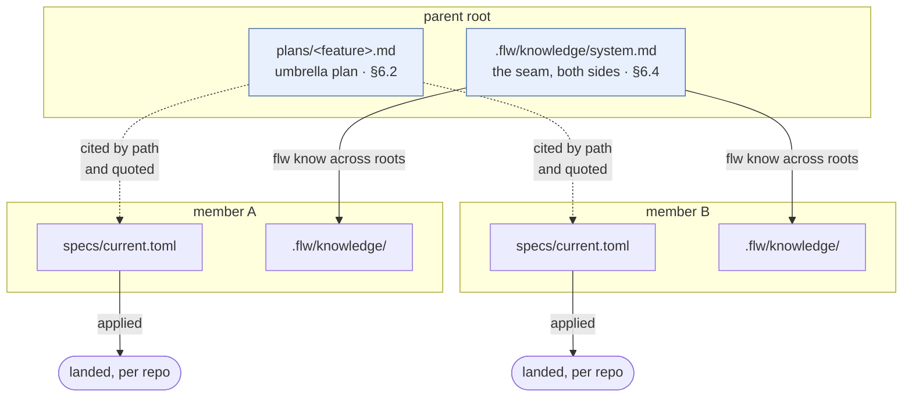
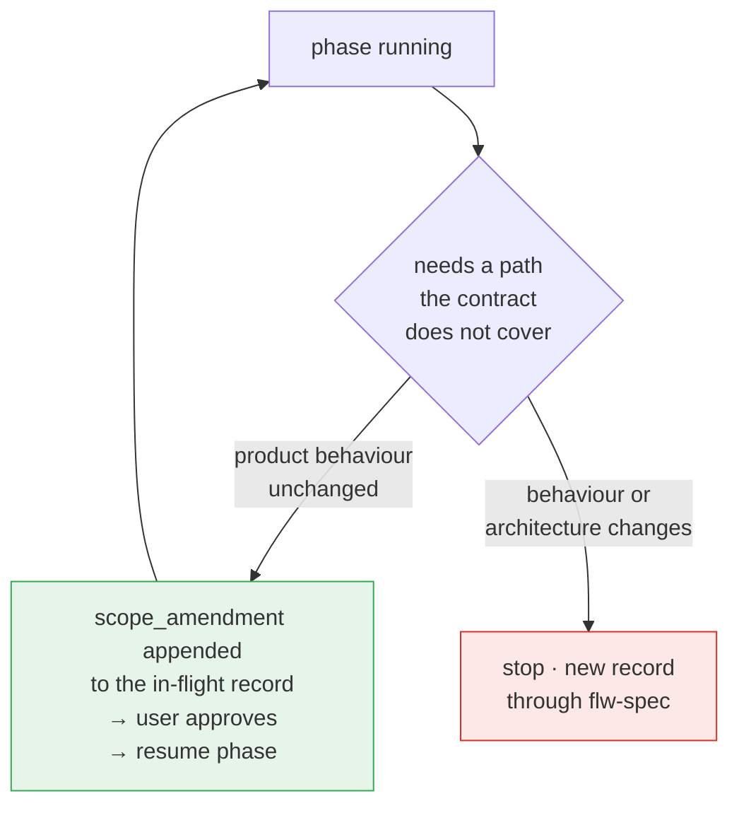
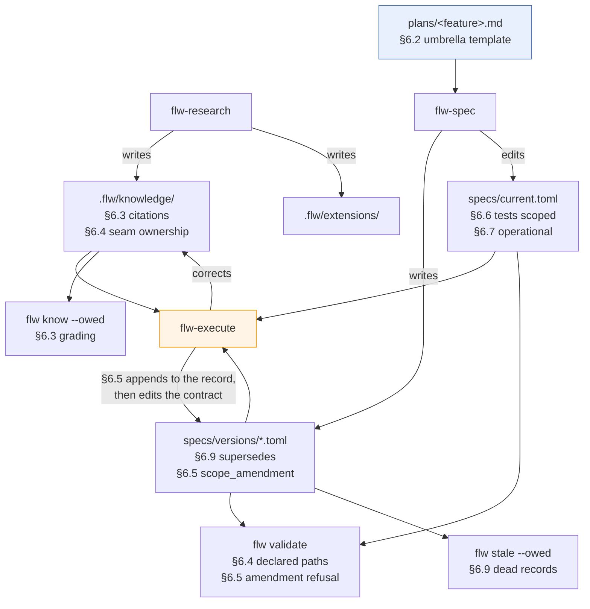

# Multi-repo coherence — design document

- **Status**: draft 2. Draft 1 was reviewed by a subagent on a fresh context; eight findings, all applied. §12 records what changed.
- **Date**: 2026-10-01
- **Revision every number below was taken at**: `72a4fd6`
- **Source**: a field report from one real engagement, `plans/codex-feedback-real-world-work.md`
- **Scope decided before drafting**: flw keeps its current scope. It does not become a delivery system.

## 1. What this document is

A design for the changeset that follows from flw's first outside field report. It covers eleven findings
from that report, filtered through one decision the user took before any of this was drafted: flw stays a
knowledge, specification and guidance system, and acquires no awareness of branches, worktrees or a pull
request host.

It is a design document and not a specification. It names the problem, the measurements, the mechanisms and
the forks that were settled. What it does not carry is a task breakdown, a phase order or a contract edit —
those are `flw-spec`'s to write, and §9 says how the work would split into records when it gets there.

Read it with the field report open. This document does not restate the report's eleven items; it says which
of them survive the scope decision, what each becomes, and why the rest were refused.

## 2. The problem

flw constrains execution well. A record says what will be built, `flw-execute` refuses to drift from it, and
`flw validate` checks that the documents still agree. That machinery is tested and in use.

What flw does not do is maintain truth as a feature changes shape over time. Three specific failures, all
observed in the field rather than reasoned about here:

**A knowledge claim cannot say what it depends on**, so staleness is reported as a diff over a directory. A
mechanism exists for clearing a claim that survived — `flw know --stamp` after a re-read — but deciding
whether to use it costs a read of the whole directory diff, which is why nobody does. §4.2 measures it.

**A declared check belongs to the project and not to any unit of work**, so an executor running the declared
set necessarily runs checks belonging to work that has not landed yet.

**A gap the contract does not cover costs a contract version**, whatever its size. Adding one registration
file that the accepted behaviour requires goes through the same amendment path as replacing durable jobs with
a process-local buffer.

And underneath all three: **multi-repo stops at the knowledge store.** `[project.roots]` drives `flw know`,
`flw map` and the member listing inside `flw context`, and neither `validate_spec.py` nor `run_tests.py` has
ever read it. So a change spanning three repositories is three independent contracts with one prose plan
above them and no standard shape for that plan. §4.7 has the real distribution.

## 3. What this is not

**Not a delivery state machine.** flw learns nothing about branches, worktrees, merge state or a pull request
host. It runs no `git` command of its own beyond what it already runs, and it does not commit or tag. Four of
the field report's eleven items, and three of its own top four priorities, require reversing this. They are
refused in §8.

**Not a dependency graph.** No machine-readable edge between records, no cycle validation, no `flw graph`.
The user's reason is the stronger one: arriving at the final shape of the engagement took many unexpected
turns, and an artifact flw validates punishes the turn. flw also already refused the narrower version of this
at `core/scripts/validate_spec.py:537`:

> There is no chain any more. A `base` pointer chain gives each record exactly one predecessor, which is
> precisely what two people speccing in parallel from the same contract cannot both have.

That decision was about landing order being unknowable in advance. A declared dependency is a different
statement, and a set of them never produces the single predecessor it ruled out — so the refusal in this
document rests on the user's reason rather than on that one. It is quoted because a later reader proposing
record ordering will meet it first and should know it is not the whole argument.

**Not a second contract layer.** There is no parent-level `specs/current.toml`. §6.2 says why.

**Not a taxonomy for knowledge material.** The report proposes splitting knowledge into facts, rules and
decisions. flw already separates those into three stores — facts in the knowledge store, rules in extensions,
decisions in a record's `decisions`. A fourth copy of that distinction inside one file is refused in §8.

## 4. Measured

Every figure below carries the command that produced it. All were taken at `72a4fd6` on 2026-10-01.

### 4.1 The knowledge store does not exist outside this repository

```sh
for p in <each project with a .flw directory>; do
  ls   $p/specs/versions/*.toml           | wc -l   # records
  find $p/.flw/knowledge  -name '*.md'    | wc -l   # knowledge files
  find $p/.flw/extensions -name '*.md'    | wc -l   # extensions
  git -C $p log -1 --date=short --format=%ad
done
```

`find` rather than `ls`, because both stores nest: `ls .flw/knowledge/*.md` returns 2 here and the store
holds 17.

```text
                 records   knowledge   extensions   last commit
flw                   60          17            4   2026-09-16
punto                 19           0            0   2026-10-01
mortgauge              6           0            0   2026-09-16
flathunt               0           0            3   2026-08-22
```

Twenty-five records have been written outside this repository and not one knowledge file exists anywhere but
here. This is the measurement that should order the whole changeset.

`punto` read 15 records an hour before this table was taken and 19 when it was. A session is working in it
now, so treat the record counts as live and the knowledge column as the stable finding.

**The consequence, stated carefully.** `flw know --owed`, shipped at `ee43bf8` and wired into
`flw-execute`'s phase boundary, exits 0 in every project except this one. That is not an oversight: a root
with no store printing `no store` and exiting 0 is a recorded decision in
`specs/versions/knowledge-store-minor.toml`, chosen over exiting 1, with the rationale that "every repo has no
store until research writes one". The gate was built to be inert until a store exists.

What nobody noticed is that the inertness became permanent, because `flw-research` is the only thing that
creates a store and it is the skill that runs once at adoption — the moment at which nobody yet has a reason
to run it. Three projects adopted flw, wrote 25 records between them, and never ran it.

### 4.2 Staleness is reported as a directory diff, and the clearing path is never used

```sh
flw stale
```

```text
KNOWLEDGE  (8)
  changed under  (2)
  - flw/flw.md — 17 files · +2444 −71
  - flw/specs/specs.md — 3 files · +427 −8
```

Seventeen files moved under `flw.md`. Nothing in that row says whether any claim in the file is now false.

**A mechanism for clearing it already exists.** `core/skills/flw-research/references/recheck.md:42` says:
"The claim survived and only the revision is behind → re-stamp it." So these rows are red because the
re-check was never run, which is a usage gap rather than a missing state.

**The reason it is never run is the finding.** Deciding whether to re-stamp `flw.md` means reading the diff
of all 17 changed files to find out whether any claim in it broke. The cost of the decision is proportional
to the directory diff and not to the number of claims, so the cheap answer is always to leave the row red.
Both rows have been red since `a53d68f`, which predates the work that produced them.

The field report hit the same thing at larger scale: six knowledge pages in the runner repository marked
changed by unrelated edits, with the observation that their claims may still be correct. This is the one
measurement that reproduces identically in both repositories, which is what makes it a property of the design
rather than of either setup. §6.3 is the only mechanism in this document aimed at it.

### 4.3 Checks are one flat list

```sh
python -c "import json; s=json.load(open('core/schemas/spec-v4.schema.json')); \
           print(sorted(s['properties']['success_criteria']['properties']))"
```

```text
['criteria', 'tests']
```

`success_criteria.tests` has no per-record, per-phase or per-repository scoping. An executor running the
declared set therefore runs checks belonging to work that has not landed. The field report's executor stopped
for exactly this reason, and it was correct to stop — the schema was behaving as designed.

flw has hit the same deadlock from the other side twice, on 4.2 and on `knowledge-base`, which is why
`flw-spec` now carries a rule telling a record to declare its subcommand surface at spec time. That rule
treats the symptom in one direction only.

### 4.4 A record has no way to express a scope-only change

```sh
python -c "import json; s=json.load(open('core/schemas/version.schema.json')); \
           print(sorted(s['properties']))"
```

```text
['approach', 'base', 'contract_edit', 'dag', 'decisions', 'name', 'release_line',
 'sources', 'spec_version', 'summary']
```

Nothing here expresses "add this path, product behaviour unchanged". So an executor that finds it needs one
file the contract does not cover must stop and route through `flw-spec` for a full record, which is the
heaviest path flw has.

### 4.5 The budget is the constraint that decides the form of every fix

```sh
.venv/bin/python core/scripts/budget.py
```

```text
  OK  core/skills/flw-execute/SKILL.md   19450 / 21000  (+1550)
  OK  core/skills/flw-research/SKILL.md  20853 / 21000  (+147)
  OK  core/skills/flw-review/SKILL.md    12445 / 21000  (+8555)
  OK  core/skills/flw-spec/SKILL.md      20984 / 21000  (+16)
  OK  core/styles/terse_prose.md          9973 / 10000  (+27)
  OK  core/shared/context.md              8615 / 10000  (+1385)
```

flw-spec has 16 bytes free and flw-research has 147. Both are at the ceiling, and flw-execute's 1,550 is less
than §6.5's amendment step needs — that section's prose here is about 1,900 bytes without its diagram. Three
of the four skills are therefore constrained, not two.

The asymmetry explains which files are stuck. Weight pushed into `references/`, which loads only when a run
needs it:

```sh
for s in flw-spec flw-execute flw-research flw-review; do
  cat core/skills/$s/references/*.md | wc -c
done
```

```text
flw-review     12027 B of references against a 12445 B trunk   → 8555 B free
flw-spec        5854 B                                          →   16 B free
flw-research    4003 B                                          →  147 B free
flw-execute     2593 B                                          → 1550 B free
```

flw-review carries as much in references as in its trunk and has the most headroom in the system as a result.
The files at the ceiling are the ones that kept everything in the trunk. Compression of wording is nearly
spent; the remaining move is structural.

### 4.6 The per-run instruction cost, for context

```sh
flw context <skill> | wc -c
```

```text
flw-spec      context 11587 B + SKILL 20984 B = 32571 B  ≈ 8100 tokens
flw-execute   context 11552 B + SKILL 19450 B = 31002 B  ≈ 7750 tokens
flw-research  context 10739 B + SKILL 20853 B = 31592 B  ≈ 7900 tokens
flw-review    context 11573 B + SKILL 12445 B = 24018 B  ≈ 6000 tokens
```

Add the style at 9973 B and `ambient.md` at 5668 B, which load per session rather than per run. A spec run
spends about 12,000 tokens on instruction before it reads a line of the project, which is 6% of a 200k window.

This is recorded to close the question rather than to open one: token cost is not a problem worth optimising,
and the byte budget in §4.5 binds as a *writing* constraint, not as a cost one. No mechanism below is shaped
by token economy.

### 4.7 Multi-repo reaches `flw know` and stops short of the contract

```sh
grep -rn "project.roots\|\[project\]" core/scripts/*.py cli/flw.py core/schemas/*.json | awk -F: '{print $1}' | sort | uniq -c
```

```text
  13 cli/flw.py
   2 core/scripts/knowledge.py
   1 core/scripts/stale.py
```

`project_roots()` is defined at `cli/flw.py:2452` and has five call sites: the member listing, `flw know`,
its check and map forms, and `flw stale`. One of those listings runs inside `flw context`, so every skill
including `flw-spec` already sees the declared members at its opening.

What has never read it is the specification machinery: `core/scripts/validate_spec.py` and
`core/scripts/run_tests.py` contain no reference to it. A contract knows nothing about a sibling contract,
which is the gap §6.2 works around rather than closes.

## 5. The source, and what it is worth

This changeset exists because of one document: a field report from a real multi-repository, pull-request-based
engagement, dictated and lightly garbled. It is the first evidence about flw that was not produced by an agent
of the same kind that wrote flw.

Its value is visible by comparison. Review teams run against flw's own tree in the preceding weeks returned
findings about wording and confirmed things that had already been verified. This one document produced eleven
findings, three of which reproduce in flw's own tree at the revision above — §4.2, §4.3 and §4.4 are all its
observations, re-measured here before being accepted.

Two consequences for how the work proceeds:

**The report had to survive**, so it is in the repository at `plans/codex-feedback-real-world-work.md`. It
arrived in a home directory, untracked, and every record in this changeset names it in `sources` — so leaving
it there would have manufactured an eleventh row in the ten dead citations `flw stale` already reports. It is
copied verbatim, dictation artifacts included, because a source that has been tidied is a source nobody can
check.

**The next round of evidence should be another engagement, not another review team.** §4.1 says flw has three
adopted projects with no knowledge store, so there is a cheap way to get it: use flw end to end on the next
real change in `punto` or `mortgauge`, research first so a store exists. Review teams are retired against
flw's own code until there is code an agent did not write.

## 6. The design

### 6.1 The principle

> **Record what is true. Never enforce a shape the design has not settled.**

Every mechanism below either grades a claim against evidence, or writes down a structure a human already
decided. None validates a shape the work is still discovering, which is the line the refused dependency graph
crossed.

The principle from `design-the-loop.md` still governs where a mechanism touches a record: prefer a
computation; use a field only where `flw validate` refuses a record without it; never rely on a sentence for
anything the next lane depends on. Two mechanisms below deliberately break the last clause — §6.2 and §6.8
are prose by design — and both say why in place.



The parent holds one plan and one knowledge file. Every member keeps its own contract, its own records and its
own numbering. Nothing at the parent is read by the specification machinery, which is what keeps the diagram
honest: the dotted edges are prose citations a human maintains, and the solid ones are computations.

### 6.2 The umbrella plan, as a template

`flw-spec` already requires one plan at the parent for a cross-repository change, written before any
repository specs its own record, with every record citing it by path in `approach`. The rule exists at
`core/skills/flw-spec/SKILL.md:163`. What is missing is any standard shape for that plan, so each one is
invented and none is comparable to the last.

The mechanism is a template at `core/skills/flw-spec/references/umbrella-plan.md`, plus one sentence in
flw-spec's existing cross-repository paragraph pointing at it. Six sections in fixed order:

```text
# <feature> — umbrella plan

## What this is
One paragraph. The behaviour all the repos are serving, and what would make it a failure.

## Repos and what each owns
**datastore** — owns the items table and its schema.
**runner** — reads items. Owns nothing in the wire shape.
**api** — exposes items outward. Owns the public field names.

## The seam
**items[].id** — datastore owns, runner and api read.
**items[].label** — datastore owns, api renames to `title` outward.
**items[].retired_at** — datastore owns, nullable, runner must tolerate null.

## Slices
Indentation is dependency: a line needs the line it sits under.

datastore:add-items-field          landed        #412
  runner:read-items                open          #418
    runner:surface-items           not started
  api:expose-items                 open          #419
       (also needs runner:read-items)

## Order that matters, and order that does not
runner:read-items and api:expose-items are independent of each other.
Nothing requires api before runner.

## What we expect to change
The retired_at nullability is unsettled. If it becomes non-null,
runner:read-items is rewritten and surface-items is unaffected.
```

**Indentation rather than arrows, and that is a decision.** A box-drawing layout was drafted first and thrown
away: an agent redrawing a `└─▶` picture after one slice moves produces a different layout each time, and a
template whose purpose is to be standard cannot be the part that drifts. Indentation has one rule, survives
renaming, and a new slice costs one line at one depth.

The cost is that indentation cannot express a slice needing two parents, which is why `(also needs …)` is in
the template. One prose escape hatch beats a notation that covers every shape, because the shapes are not
known in advance.

**`landed` is deliberately the same word as the contract's `applied`**, so the plan and the contract agree on
what the term means. The pull request number sits on the line as text. flw never parses it and never asks a
host about it — which is the entire concession that keeps this inside scope while still answering "how do
these pull requests depend on each other".

**Why the umbrella is a plan and not a contract.** Three reasons, each sufficient alone:

`nearest_project()` returns the innermost root of the project chain, so a member always resolves its own
contract. A parent contract would be a document that every member's own tooling never loads.

Extensions are read along that same chain, and `[project.roots]` does not require nesting — `project_roots()`
resolves a declared `../datastore` to a sibling. A parent contract would reach the members that nest under it
and silently miss the ones that do not.

A second contract layer doubles every rule about `spec_version` folding and forces `flw validate` to decide
which contract a record belongs to.

**The caveat, and the instruction it needs.** A hand-maintained diagram goes stale and nothing will say so.
The mitigation is that the plan is rewritten rather than patched whenever a spec session touches the feature,
and the template is small enough that redrawing beats editing.

flw-spec does not currently say this. `SKILL.md:163` says the plan is written before any repository specs its
own record and says nothing about revisiting it, so the rewrite expectation is a new instruction in the
pointer sentence rather than an existing rule being invoked. The template states it too, so the next reader
treats a stale diagram as expected rather than as a defect in the method.

### 6.3 Claim-level citations

A claim cites the evidence it rests on, as a path and a symbol: `core/scripts/stale.py:owed_rows`. The store
then grades a diff instead of reporting it:

- the cited symbol changed — the claim is probably false, report red
- the cited symbol moved file — report, but as a relocation rather than a falsification
- the cited symbol is gone — report red, loudest case
- another file under the path changed and no cited symbol moved — report nothing
- a citation into another declared root whose symbol moved — report, which is the only staleness class in the
  field report's list that crosses a repository boundary
- the file was re-stamped at a revision later than the diff — report nothing, which is the existing
  `flw know --stamp` path doing what it already does

This is the only mechanism in the document aimed at §4.2, and the largest single piece of work in the
changeset. It is also the most aligned with what flw is for.

**What it fixes is the cost of the decision, not a missing state.** Re-stamping a file whose claims survived
already works. What citations change is that the re-check reads the diff of the cited symbols rather than the
diff of the whole directory, which is what turns a decision nobody takes into one that is cheap enough to
take. Draft 1 proposed a separate "verified at revision" state and a record to build it; §12.1 says why that
was withdrawn.

**What it does not do:** it does not verify that a citation is accurate when written. An agent can cite a
symbol that has nothing to do with the claim, and nothing will catch it. The grading is only as good as the
citation, and the honest framing is that this converts an ungraded report into a graded one, not a guess into
a proof.

**The cross-root class is the weakest of the six** and should be built last or not at all. It requires both
roots present in the session; a member checked out alone has to report the citation as unresolvable rather
than as satisfied, the same failure mode §6.2 works around.

### 6.4 A declared path with nothing behind it

A component declares `paths`. Nothing checks that those paths still exist, so a contract can describe a
fileset the repository no longer has and `flw validate` passes.

One new row: a declared path with no file or directory behind it. Measured against this tree, it has 0 hits,
and it is refused nowhere in the records.

**The converse row is refused and stays refused.** Draft 1 also proposed reporting a file that no component
claims. `specs/versions/finish-the-opening-minor.toml:96` put exactly that question — "whether every tracked
top-level path must belong to a component" — and chose "no — unclaimed is legitimate, said once in
assumptions", because "enforcement makes every new top-level file a contract change". `specs/current.toml:61`
carries it as an assumption: "a path claimed by none is a state, not a gap, and flw validate does not check
for it."

The narrow version, limited to directories a component already touches, is quiet — 1 hit on this tree,
`core/scripts/__init__.py` — and quiet is not the objection. The objection is that it makes a new file a
contract change, which is true at any volume. §12.2 records the withdrawal.

**Seam ownership in the store** rides along as guidance rather than code. `flw-research` already greps for
literals duplicated across roots and writes a seam from both sides in its example. The change is one
instruction: a seam file names which side owns each field and which sides copy it, matching the template's
`## The seam` section so the plan and the store use the same vocabulary.

### 6.5 The scope amendment, and the rule that classifies it

An executor that needs one file the contract does not cover appends a block to **the record it is executing**,
rather than stopping for a full record of its own:

```toml
[scope_amendment]
component = "scripts"
add = ["core/scripts/render.py"]
reason = "existing registration point required by the accepted behaviour"
product_behaviour = "unchanged"
```

The user approves, flw adds the path to the named component, and **the run resumes from the phase that
stopped**. The no-drift rule is intact because approval still happens; what goes away is charging a contract
version for a registration file.

**The block lives in the record's own file, and that placement is the mechanism.** A path that reaches the
contract with no record explaining it is the pattern `specs/versions/` exists to prevent, and `flw validate`
reads records and the contract — so a block written only into a reply is one nothing can check and nothing
preserves.



**The classification rule is the mechanism, not the field.** Adding a required integration file is an
amendment. Replacing durable jobs with a process-local buffer is a new record. Written once, it also answers
the field report's separate question about which review comments need a re-spec — so that item needs no
machinery of its own.

**What `flw validate` can actually refuse.** A block whose `component` names no component in the contract,
and a block whose `product_behaviour` is anything other than `"unchanged"` — an executor that needs to say
behaviour changed is an executor that needs `flw-spec`. Draft 1 claimed the refusal would cover an amendment
touching `properties` or `surfaces`; an `add = [paths]` block cannot touch either by construction, so that
check was constant-false. §12.3.

The residual risk is real and the checks above do not remove it: this is the one mechanism that makes drift
cheaper, and a wrongly classified amendment is drift the user approved without understanding.
`product_behaviour` is self-reported, and the first few amendments should be read closely rather than waved
through.

**Cost, which lands in the wrong file.** The amendment step belongs in flw-execute's trunk, which has 1,550
bytes free against roughly 1,900 bytes of prose. flw-execute therefore joins §6.11's references move.

### 6.6 A check that declares what it requires

Each entry in `success_criteria.tests` gains an optional required path. `run_tests.py` skips a check whose
required path is absent and says it skipped it.

This closes §4.3 in both directions at once. An executor stops running checks for work that has not landed,
and a project whose contract declares a surface before building it stops deadlocking against its own test —
the problem flw hit on 4.2 and on `knowledge-base` and currently treats with a rule in `flw-spec` telling
records to declare surfaces early. That rule can stay, but it stops being the only defence.

**A skip is a hand-back, not a pass.** `specs/versions/test-reporting-major.toml:71` has `-A` failing on any
unrunnable check, and `specs/current.toml:175` makes exit 2 "a run that proved nothing". A required-path skip
is a third kind of not-run, so it needs both answers stated: under `-A` a skip is a hand-back and fails the
run, and a run that skipped every check exits 2. Otherwise this mechanism becomes a way for a run to prove
nothing and report success.

Draft 1 also proposed reporting an infrastructure failure — a service not running — as its own outcome. That
is refused in §8: the contract forbids inferring anything from an exit code, and the declared form already
exists.

### 6.7 Operational verification, recorded as owed

`success_criteria` gains an `operational` list beside `tests`: what must be checked against a real environment
— configuration, feature flags, deployment topology, external services — and what evidence counts as proof.

flw runs none of it. It records that the work is owed and reports it unsatisfied, exactly as `[tests] yours`
works today. This encodes the lesson that produced the field report in the first place: the implementation
passed its tests, and the most valuable evidence came from a real run.

It is also where the field report's last autonomy item lands — the external alterations that remain
user-owned are `[tests] yours` for checks and this list for everything a real environment has to prove.

### 6.8 The wire fixture, as a convention first

One shared fixture at the parent describing the wire shape, and each member declaring a check that validates
the fixture against its own schema. It turns the template's `## The seam` section from a written agreement
into a cheap executable one, and it catches the case prose cannot: two repositories passing independently
while disagreeing on a field name, an alias or nullability.

**Recorded as a convention before any flw code is written.** The fixture is a file and the check is a line in
`[tests] checks`, so flw needs nothing new to support it. If two repositories adopt it and it holds, then
decide whether it deserves a command. Building the command first would be designing for a usage pattern that
has one data point.

### 6.9 Supersession

A record gains `supersedes = ["<name>"]`, and `flw stale --owed` counts a superseded unapplied record as dead
rather than in flight.

**This is the one machine-readable field in the changeset, and it looks superficially like what §3 refused.**
It is not an ordering or a dependency. It is a retirement marker: the design turned, the older record is
never going to land, and saying so is cheaper than leaving it to report as work in progress forever. It makes
change cheaper rather than more rigid, which is the test §6.1 sets. Nothing reads it beyond `--owed`, and
nothing validates an order from it.

It also closes the field report's complaint that stale records survive indefinitely unless somebody remembers
to clean them up — together with the landing derivation shipped at `ee43bf8`, which already answers whether a
record's work reached the tree.

### 6.10 Autonomy boundaries, documented rather than built

The field report asks flw to record seven things so that a separate manager agent becomes unnecessary. Five
already have a home:

- decisions already approved — a record's `decisions`
- decisions still requiring the user — `open_questions`
- files and behaviour the executor may change — a component's `paths`, `properties` and `surfaces`
- which tests and commits are authorised — `success_criteria.tests`, `[tests] checks`, and `commits.md` plus
  propose-never-perform
- which external alterations remain user-owned — `[tests] yours` and §6.7's `operational` list

The two missing are §6.5's classification of a gap and §6.6's answer for what a skip means. So this item is
one reference file naming where each boundary is recorded, not new machinery.

Its closing claim is worth carrying into the file, because it is measured rather than asserted: a management
agent mostly repeats context and raises cost. §5 found the same thing from the other direction — review teams
against flw's own tree confirmed what had already been verified.

### 6.11 The `references/` move, which comes first

§4.5 is the constraint. flw-spec has 16 bytes, flw-research has 147, and flw-execute's 1,550 is short of what
§6.5 needs. §6.2, §6.5, §6.6 and §6.10 all add rules to those three.

The candidates are the sections that apply to a minority of runs:

- flw-spec's thrifty mode block
- flw-spec's cross-repository plan rules, which §6.2's template supersedes in part
- the parts of flw-spec step 5 that only matter when a record declares `release_line`
- flw-research's re-check mode, which already has a reference file to join
- flw-execute's `--auto` and `--yolo` report shapes, which only one run in many prints

This is a pure refactor with no behaviour change, which makes it the one piece of the changeset that can be
reviewed by diffing the concatenation of trunk and references for equality.

## 7. What the field report asked for that is built here

A map, so nothing is silently dropped. The report's eleven items, by its own numbering:

**1** feature contract and PR slices → refused, §8, except 1.5 supersession → §6.9. Item 1.6, acceptance
criteria mapped per slice, falls with slices.
**2** `flw reconcile` → refused as a command, §8. Rows 1 and 2 are answered by `ee43bf8` and §6.9; row 6 is
§6.4's surviving half.
**3** multi-repo first class → §6.2's template and §6.4's seam ownership. Release ordering and deployment
config refused with slices.
**4** executable wire fixture → §6.8.
**5** knowledge provenance → §6.3, all five of its staleness classes including the cross-repository one. The
fact, rule and decision taxonomy refused, §8.
**6** cheap scope amendment → §6.5.
**7** checks per slice → §6.6. Its test-ownership taxonomy is `[tests] checks`, `[tests] yours` and §6.7; the
infrastructure class is refused, §8.
**8** worktree and stack registry → refused, §8.
**9** review comment ingestion → refused, §8; the classification half is §6.5's rule.
**10** post-deployment verification → §6.7.
**11** autonomy boundaries → §6.10, which maps all seven.

## 8. Deliberately not built

**A feature contract above repository contracts.** §6.2 gives three reasons the umbrella is a plan.

**Pull request delivery slices, a dependency graph, `flw graph`, cycle validation.** Refused by the user on
the ground that matters: the engagement reached its final shape through many unexpected turns, and a validated
graph is wrong the moment the design moves while still costing a correction every time. The plan's
indentation block carries the same information and costs one line to redraw. Acceptance criteria mapped
per slice falls with this, since there are no slices to map onto.

**`flw reconcile`.** Two of its seven rows survive the scope decision — superseded records, §6.9, and
declared paths with nothing behind them, §6.4 — and both belong in commands that already exist. A new command
for them would import the delivery model the scope decision refused. The other five rows are branch state,
worktree presence, pull request descriptions and host disagreement.

**A worktree and stacked-branch registry.** Real cost in the field, but answering which directory a branch
lives in is git tooling wearing an flw badge. The contract has no part in it.

**Review comment ingestion.** Needs a pull request host. The one part worth keeping — classifying a comment as
needing a re-spec or not — is §6.5's rule applied to a different input, and needs nothing built.

**A report of files no component claims.** Refused by `finish-the-opening-minor.toml:96` and by a standing
assumption in the contract. §6.4.

**Infrastructure failure as an inferred outcome.** `specs/versions/shape-independence-major.toml` chose
"delete automatic detection"; `specs/current.toml:226` says "Nothing is inferred from a check's exit code: no
code distinguishes a command that is absent from one that ran and failed"; and
`core/skills/flw-execute/references/checks.md:39` says "You may not reclassify it." Inferring reverses the
decision and declaring is already `[tests] yours`, with `setup` covering the service-not-running case. There
is nowhere left for it to stand.

**The fact, rule and decision taxonomy.** Three stores already carry that distinction. §3.

**Anything shaped by token cost.** §4.6 measures it at 6% of a window for the heaviest lane. The byte budget
binds; the token bill does not.

## 9. Where it sits in the machinery



Every touched surface already exists and gains rows rather than replacing anything. The one genuinely new edge
is `flw-execute` writing to the record it is executing and then to the contract, which is the only mechanism
here that gives a lane a write it did not have.

## 10. How it would break into records

Not a specification, and the order is a recommendation rather than a dependency graph. Six records.

**R0 — the `references/` move.** §6.11. No behaviour change. Prerequisite for everything else by §4.5, and it
now covers three skills rather than two.

**R1 — the umbrella plan template and the autonomy reference.** §6.2 and §6.10. Two reference files and two
pointer sentences, one of which carries a new instruction about rewriting the plan. Mostly prose, no code, and
the record that most directly answers the field report's multi-repository complaint. Supersession (§6.9) and
the seam ownership guidance (§6.4) fold in here, as does the wire fixture convention (§6.8).

**R2 — the scope amendment and its classification.** §6.5. Behaviour change in `flw-execute`, a schema
addition and two refusals in `flw validate`. Major, because a run that used to stop now continues.

**R3 — checks that declare what they require.** §6.6. Schema, `run_tests.py`, and the `-A` and exit-2
answers, which are a contract edit rather than only code.

**R4 — declared paths and operational criteria.** §6.4's surviving row and §6.7. Both are `flw validate` and
schema work, small enough to share a record.

**R5 — claim-level citations.** §6.3. The largest piece, deliberately last, and the only one aimed at §4.2.
Its cross-root class is the part to cut first if the record grows.

**Whether this changeset moves the release line is an open question**, not a decision taken here. See §11.

## 11. Cost

Code, by module:

- `core/scripts/knowledge.py` — R5. The bulk of the implementation, and all of it in one record.
- `core/scripts/validate_spec.py` — R4's row, R2's two amendment refusals, R1's `supersedes`.
- `core/scripts/run_tests.py` — R3's skip, its reporting, and its interaction with `-A`.
- `core/scripts/stale.py` — R1's dead-record row.
- `core/schemas/` — `scope_amendment`, `supersedes`, a required path on a check, `operational`.
- `cli/flw.py` — whatever surface R2 and R3 expose, declared at spec time per `flw-spec`'s existing rule.

Prose, by file:

- two new `references/` files, one for the umbrella template and one for the autonomy boundaries
- sections moved out of the flw-spec, flw-research and flw-execute trunks, and the pointer sentences
  replacing them
- flw-execute's amendment step
- flw-research's seam ownership instruction

Nothing here needs a new command, and that is a deliberate property rather than an accident: every mechanism
attaches to `flw validate`, `flw stale`, `flw know` or `run_tests.py`, all of which a project already runs.

## 12. What the first draft got wrong

Four withdrawals and one measurement correction, all found by a subagent review on a fresh context. Recorded
because three of the four were re-proposals of decisions already in the records, which is the failure mode
this project keeps hitting.

### 12.1 A "third state" for knowledge that already exists

Draft 1 proposed a state between stamped and falsified — re-read and still true — and a record to build it.
`core/skills/flw-research/references/recheck.md:42` already says to re-stamp a file whose claim survived, and
`flw know --stamp` writes HEAD and touches nothing else. The state exists; what is missing is a reason to
reach for it, because the decision costs a read of the whole directory diff.

The correction improved the design. §6.3's citations lost a prerequisite that was never real and gained their
actual justification, and the knowledge work went from two records to one.

### 12.2 A report of unclaimed files, refused twice before

Draft 1's second validate row re-proposed what `finish-the-opening-minor.toml:96` refused and what
`specs/current.toml:61` carries as a standing assumption. The review also measured the narrow version at 1 hit
on this tree, which draft 1 had listed as an open question — so the open question was answerable and the
mechanism was still refused.

### 12.3 An amendment refusal that could never fire

Draft 1 said `flw validate` would refuse a scope amendment touching `properties` or `surfaces`. An
`add = [paths]` block cannot touch either, so the check was constant-false and the mitigation it was offered
as did not exist. §6.5 now refuses on an unknown `component` and on a `product_behaviour` other than
`"unchanged"`, and says plainly that the residual risk remains.

Draft 1 also never said which file the amendment block lives in, which left `flw validate` with nothing to
read and the contract gaining a path no record explained.

### 12.4 Infrastructure failure as an outcome, closed off in three places

Draft 1 proposed it and flagged it as likely to be cut. The review found it was not merely low value but
refused: a record, a contract assumption and `checks.md` each close one of the two routes to it. §8.

### 12.5 Four cells in §4.1 and one count

The table gave flw 2 extensions where `find` gives 4, a last commit of 2026-09-28 where `git log -1` at
`72a4fd6` gives 2026-09-16, and punto 15 records where it now has 19. The stated command used `ls`, which
misses a nested store — flw's 17 knowledge files read as 2. "Twenty-one records outside this repository" was
25.

The conclusion held, which is the only reason this is last rather than first: no knowledge store exists
outside flw. The 2026-09-28 error was the session's own date written in place of a commit date.

Separately, draft 1 presented `flw know --owed` exiting 0 on an empty store as an unnoticed consequence. It is
a recorded decision in `knowledge-store-minor.toml`, taken for this exact case. §4.1 now says what was
actually unnoticed, which is that the inertness became permanent.

## 13. Open questions

**Does this move the release line?** flw is at 0.17.1 and the user describes this as a new version of flw.
flw's own rule puts line 1 at whatever reached production, and flw has no production. Declaring
`release_line = 1` on R1 would restart the count at 1.0.0. This is the user's call and nothing here depends on
it.

**Does `product_behaviour = "unchanged"` hold up as a declaration?** §6.5 rests on an executor classifying its
own gap honestly. The two refusals are structural checks on the shape of the block, not on the truth of that
field, which stays self-reported.

**Is the cross-root citation class worth building?** §6.3's sixth staleness class is the only one that crosses
a repository boundary and the only one that can report unresolvable. It may be cheaper to leave a cross-repo
claim ungraded and let the seam file carry it as prose.

**Who writes the umbrella plan when the members have no common parent on disk?** `[project.roots]` does not
require nesting, so a set of siblings has no natural parent directory to hold the plan. The template assumes
one. A declared-but-not-nested layout needs an answer, and the honest default is that the plan goes wherever
`[project.roots]` is declared, since that file is already the only thing naming the set.
