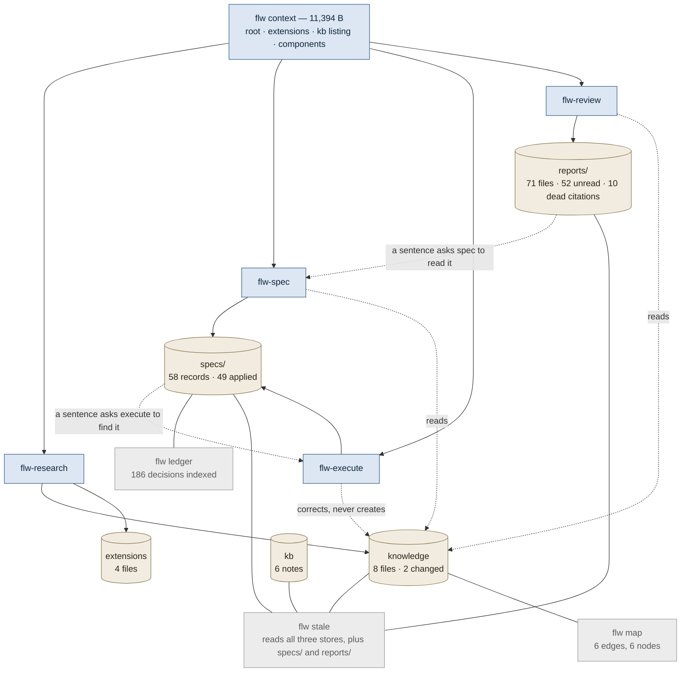
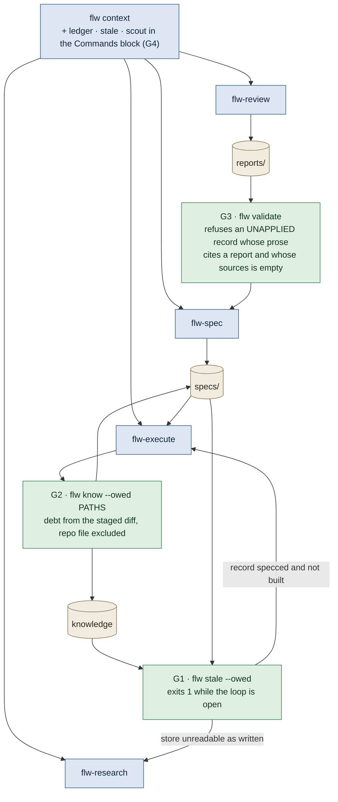
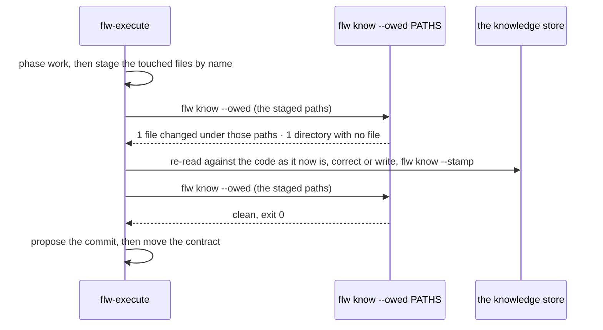

# flw's loop — design document

**Status**: second draft. Nothing built, nothing specced. The first draft proposed four gates; a
review returned four CRITICAL and four MAJOR findings, two of which were structural rather than
textual. §5 is what it got wrong and what changed because of it. One gate was withdrawn, one was
renamed, and one number in the evidence base was wrong.
· **Date**: 2026-09-11
· **Contract at**: 0.16.3
**Evidence base**: every number below was measured in this checkout at `7870d15` on 2026-09-11,
with the command that produced it given beside it. The figures in §4.2 come from a script over
`stale.cited` and `stale.marked`, printed in full there so it can be re-run. Every figure except
one was re-measured by a second reader; §5.1 is the one that was wrong.

---

## 1. What this document is

A design for closing flw's own loop: making what one lane learns reach the next lane without a
human remembering to carry it.

flw has five lanes and three stores. The lanes never call each other. They cooperate through disk,
and **every handoff that crosses a lane boundary is a sentence in a `SKILL.md` asking an agent to
go and look.** That mechanism works when the agent reads the sentence and chooses to act on it,
and it is the only mechanism flw currently has for anything crossing a boundary.

This document proposes three gates that convert the load-bearing handoffs from sentences into
computations, one advertisement change that costs no skill prose, and one widening of the knowledge
carve-out. It changes no lane's promise: review still fixes nothing, spec still writes no code,
research still records what is and never what must be.

This is not a spec. It says what the thing is, what it refuses to be, and what is still open.
`flw-spec` turns it into a contract amendment afterwards.

**Counting the stores.** flw has three stores — extensions, knowledge, `flw kb` — and
`core/shared/context.md:66` names them under that heading. `specs/` and `.flw/reports/` are also
read and written across lanes, and this document calls them artifacts rather than stores, because
the sorting question in the shared context is about the three and adding two to it would make that
rule read as covering five things it does not cover.

## 2. The problem

flw is nine scripts and five skills, and the integration between them is almost entirely prose.

At the code level there is one real integrator. `core/scripts/stale.py` imports `knowledge`,
`ledger` and `store`, which makes it the only module that can see all three stores at once. Its own
docstring says so: *"the import chain runs one way — `validate_spec <- ledger <- store <-
knowledge` — and this module sits above all of it."* No lane invokes it.

At the skill level there is one joint. Every lane opens with `flw context`, which prints the shared
context, the resolved root, the live extensions, the note-store listing for the category, and the
contract's components — 11,394 bytes for `flw-spec` in this repository. Everything past that
opening is discretionary.

The consequence is that flw's quality of integration equals its agents' rate of compliance with
prose. That is not a number anyone can measure per run, and the artifacts show what it averages to
over 58 records: §4 has the figures.



Solid arrows are a lane's own output, which happens because producing it is the lane's job. Dotted
arrows depend on an agent reading a sentence and choosing to act. Grey nodes are commands that read
the stores and that no lane invokes.

## 3. What this is not

**Not a new store.** flw has three and the sorting rule between them works. Nothing here adds a
fourth or moves a fact between them.

**Not automation of a lane.** No gate here makes a decision, writes a record, or commits. Each one
computes a fact that is already on disk and puts it in front of the agent or fails a check.

**Not a hook layer.** flw does not intercept tool calls, and none of this does either. Every gate
is a subcommand a skill runs or a check a project declares.

**Not more prose.** §4.5 is the measurement that rules it out: the two skills that would need the
new instructions have 16 and 147 bytes of headroom against their budgets.

**Not ambient printing of the knowledge store.** The first draft proposed it, `plans/knowledge-store.md`
rules it out by name, and §5.4 is why it was withdrawn.

## 4. Measured: where the loop is open

### 4.1 The cross-lane links are sentences, and one of them does not exist at all

Grepping every skill and shared file for command invocations:

```sh
grep -rnE 'flw ledger' core/skills core/shared
```

Three hits, all in `core/skills/flw-spec/SKILL.md`, and none of them is an instruction to run it:

- `:53` — a record written to the wrong directory is one "`flw ledger` cannot find"
- `:147` — "which `flw validate` enforces and `flw ledger` reads"
- `:168` — "`flw ledger`'s corpus is bounded by the resolved project root"

`ledger.py` is 924 lines. `flw ledger` with no term reports what it holds for this repository: 58
version records, 186 decisions, 593 task descriptions, 11 files in `plans/`, 10 team configs. The
only place in the tree that teaches an agent to use it is `.flw/extensions/flw-spec.md:4`, which is
*this repository's own local extension* — flw patched itself and left the shipped skill unwired. A
project that installs flw gets the index and no instruction pointing at it.

Meanwhile the two lanes with the strongest need are told to do it by hand. `flw-review`'s "The
discipline, followed even reviewing alone" block says at `:168` "Check the contract, the version
files under `specs/versions/` before calling something a mistake"; `flw-spec`'s Amending step 1 at
`:126` says "Read the contract and the version files it has not applied". That is 58 records, read
as files, to answer a question the index answers in a second.

### 4.2 An optional field in a record gets filled 5% of the time

This is the load-bearing measurement of the whole document, because it decides whether a gate may
be built as a field an agent fills.

`version.schema.json` requires exactly two keys, `name` and `summary`. It carries an optional
`sources`: "The review reports this record was specced from, as paths relative to the project
root." `flw stale` reads it to decide which reports are spent.

```python
import sys, pathlib
sys.path.insert(0, "core/scripts")
import stale, ledger
root = pathlib.Path(".").resolve()
recs = ledger.corpus(root).records
d = root / ".flw/reports"
on_disk = {p.name for p in d.glob("*.md")}
cited = stale.cited(recs, stale.citation("reports"))
marked = stale.marked(d, stale.record_names(recs))
```

| quantity | value |
|---|---|
| reports on disk | 71 |
| records in the corpus | 58 |
| records carrying `sources` | 3 |
| reports a record cites, from `sources` or from prose | 27 |
| of those, reached through `sources` | 5 |
| of those, reached only through prose | 22 |
| of the 27, with a file behind them | 17 |
| reports carrying a hand-written `Specced as` mark | 8 |
| marked and not cited | 2 |
| dead citations — a record names it, no file is there | 10 |

**Three of fifty-eight records fill the field.** Twenty-two of the twenty-seven citations were
recovered only by matching report paths out of the prose in `summary`, `approach` and
`contract_edit` — a fallback whose limits `stale.py:132` states in its own docstring: *"It still
cannot see a negation. 'Nobody has read `.flw/reports/X.md`' counts X as spent."*

So a gate built as a field an agent is asked to fill will be filled about one time in twenty. Every
gate below is therefore either a computation over what is already on disk, or a field that
`flw validate` refuses a record without.

One incidental finding, of the exact kind `flw stale` exists to catch. `stale.py:189` says "of the
three reports marked here, two are cited by no record's prose at all". Eight are marked now. The
line was written on 2026-09-04 (`git log -L189,189:core/scripts/stale.py` → `b3fa4d5`), so a
countable in prose that nothing checks went 3 → 8 in seven days.

### 4.3 The knowledge store is maintained and never extended

`flw know --check` at HEAD:

```text
8 files · 2 changed · 0 unstamped · 6 current · 0 orphans
```

Both changed files are stamped at `a53d68f`. The store has 8 concept files, and this repository has
run `flw-research` essentially once.

Reading the four lanes for who may write it:

- **`flw-research` §4** creates files. It is the only thing that does.
- **All four lanes** carry the carve-out, whose opening clause is verbatim-identical at
  `flw-review:45`, `flw-spec:43`, `flw-execute:43` and `flw-research:67`: *"A knowledge file `flw
  know` returned that the code has already falsified is yours to correct."*
- **`flw-execute`'s phase boundary**, at `:178`, says re-read the files `flw know <path>` returns
  "and correct what is wrong".

Nothing creates a file outside a survey. So 49 applied records' worth of work landed around a store
that was told to stay accurate and never told to grow.

And staleness has no consequence, by design. The shared context states it at `:93`: *"Changed warns
and never stops."* Measured:

```sh
flw know --check >/dev/null; echo $?    # 0, with two files changed
flw stale        >/dev/null; echo $?    # 0
flw validate     >/dev/null; echo $?    # 0
```

Two of eight files disagree with the tree and every exit code in the system is 0. The only repair
path is `flw-research` re-check mode, entered by a human saying "is what we recorded still true?".

### 4.4 The one module that sees everything is invoked by nothing

`stale.py` is 392 lines and sits above the whole import chain. Its output here:

```text
REPORTS  (71)  · 19 spent, 52 nobody has read
  dead citations  (10)  · a record names it and no file is there
KNOWLEDGE  (8)
  changed under  (2)
EXTENSIONS  (4)
  claims with no revision  (6)
NOTES  (6)
  claims with no revision  (6)
```

No skill step runs it. It appears in `references/recheck.md:38` as one possible source of a path
list and in `flw-spec:251` as an explanation of what shape the report mark takes. It is a command a
human runs when they already suspect something.

### 4.5 The constraint that decides the form of every fix

```sh
.venv/bin/python core/scripts/budget.py
```

| file | bytes | ceiling | free |
|---|---|---|---|
| `core/skills/flw-spec/SKILL.md` | 20,984 | 21,000 | 16 |
| `core/skills/flw-research/SKILL.md` | 20,853 | 21,000 | 147 |
| `core/skills/flw-execute/SKILL.md` | 19,532 | 21,000 | 1,468 |
| `core/skills/flw-review/SKILL.md` | 12,445 | 21,000 | 8,555 |
| `core/shared/context.md` | 8,423 | 10,000 | 1,577 |

**`flw-spec` has sixteen bytes.** The lane that would need the most new instruction cannot take a
sentence. This is not an obstacle to route around — it is the argument the budget was put there to
make, and it points the design at the same answer §4.2 does: the teaching belongs in command
output, where it costs nothing at the opening and arrives at the moment it is needed.

`references/` files under a skill are uncapped. `budget.py:36` globs `core/skills/*/SKILL.md` and
nothing below it, which §7 uses.

## 5. What the first draft got wrong

Four findings changed the design rather than the wording. They are recorded here because each one
is a way this document could have been wrong again.

### 5.1 The one number that did not reproduce

The first draft said "the other 24 of the 27 citations" come from prose. It is 22. The error was
subtracting records from reports — 27 − 3 — when the 3 records carrying `sources` name 5 distinct
reports. Split by route: 5 from `sources`, 22 from prose, union 27.

The inference it supports survives untouched, because that inference rests on "3 of 58 records",
which reproduces exactly. But a design whose central rule is *an optional field is filled 5% of the
time* cannot afford a wrong denominator anywhere near it, and this one sat two lines away.

### 5.2 A record names no paths, so the first draft's G1 could not be computed

The first draft's `flw stale --check` failed on "a knowledge file `changed` under a path an
**applied** record touched". A record names no paths. `version.schema.json`'s top-level keys are
`base, spec_version, summary, approach, contract_edit, dag, decisions, name, sources,
release_line`, and a `dag` task carries `id, desc, depends_on` — no `paths`, `component` or
`files` anywhere. `stale.knowledge_state` at `:221` folds per file with no record dimension.

So the row reduced to "any knowledge file changed", which is 2 of 8 right now, and the draft's own
§7 said `changed` is the normal state mid-phase. It was a check red on day one, for the reason the
same document gave for why a check must not be. The row is withdrawn; §6.3 carries the whole of the
knowledge-debt job.

### 5.3 `flw stale` exits 0 as a contract property, not as an implementation detail

`specs/current.toml:134` states it under `properties`:

> flw stale exits 0 whenever it ran — including a project with no reports directory, no knowledge
> store and no notes, and including one where every document it read is stale … and 1 only for a
> `--root` it was given and could not use. Nothing it reports is a failure.

The `mark-what-is-spent` record's `stale-command` task restates it. So a flag that exits 1 is a
documented-behaviour change, and two records classify that as major on its own:
`pay-the-opening-once-minor.toml:50` declined a change because it "changes a documented behaviour
of a command and would be major".

The first draft cited only `stale.py:141`, the comment, and listed two new `surfaces` lines in its
§8 while saying nothing about the property. §6.2 now names the amendment.

It also mis-chose the flag name. `--check` in this CLI already means *reports, exit 0*:
`cli/flw.py:3666`, the `_know_check` docstring, is "The whole store, writing nothing, exit 0
whatever it finds", and `plans/knowledge-store.md:212` defines it the same way. `--owed` says what
it does and collides with nothing.

### 5.4 G4 re-proposed what a decision, a plan and two records had each declined

The first draft's G4 had `flw context --scope` print knowledge heads for the scope. Three separate
refusals stand against it:

- The `knowledge-store` record's decision *"whether flw kb and the knowledge store merge"* chose
  separate stores, and its rationale turns on exactly this: *"knowledge is addressed by path, never
  listed at opening … Merging forces either knowledge into every opening or kb out of it."*
- `plans/knowledge-store.md:372`, under "Not built, on purpose", lists *"Ambient printing of any of
  this."*
- `--scope`'s output is documented at `current.toml:133`, so changing it is major by the
  `pay-the-opening-once` precedent above.

The gate was worth one line of benefit: a compliant lane already runs `flw know <path>` because it
is told to, and G5 — now §6.5 — advertises the command at every opening for nothing. Buying an
incompliant run one less excuse does not justify reversing three recorded refusals. **Withdrawn**;
it is in §8 with the citations.

This is also the finding that matters most for how this document was produced. The first draft
argued that nobody searches the ledger before deciding, and then proposed four gates without
searching the ledger. The review found this by running `flw ledger` on nine terms.

## 6. The design

### 6.1 The principle

There are three ways to carry a fact from one lane to the next, and they have measured reliability:

1. **A sentence in a `SKILL.md`.** Fires when an agent reads it and chooses to act. flw's current
   mechanism for every cross-lane handoff.
2. **A field in a record.** Fires when an agent fills it: 3 of 58, §4.2.
3. **A computation over what is already on disk.** Fires every time, because nothing is being
   remembered.

> **Design rule: prefer 3. Use 2 only where `flw validate` refuses a record without it. Never use 1
> for anything the next lane depends on.**

Each gate below names which of the three it is.



### 6.2 G1 — `flw stale --owed`, the one command that answers "is the loop closed"

**Kind: a computation.** Nothing to declare and nothing to remember.

`flw stale` already reads every artifact and prints a human view. Add `--owed`: one line per owed
item, naming the lane that owes it, and exit 1 when anything is owed.

**The name is `--owed` and not `--check`.** §5.3: `--check` in this CLI means *reports, exit 0*, in
both places it is defined. Reusing it for a flag that exits 1 would make the idiom mean two things.

**The owed-set is narrow on purpose.** 52 of 71 reports here are unread, and that is a backlog, not
a defect — `stale.py`'s own docstring says so: *"A report nobody has read is a backlog item with a
decision attached rather than refuse."* A check that fails on the standing backlog is a check
nobody keeps. Two rows, after §5.2 withdrew the third:

| owed | means | lane |
|---|---|---|
| a knowledge file `orphaned`, `malformed` or `unstamped` | the store cannot be read as written | flw-research |
| a record in `specs/versions/` absent from `applied`, excluding legacy numbers | work specced and not built | flw-execute |

**The legacy exclusion is not optional.** The 9 records absent from `applied` here are
`1.0`–`3.4`, every one a legacy number predating the list, which `ledger.py:716` already excludes
to print "49 applied, 9 predating the count". Without the exclusion the row is red on day one in
this repository and in every project that ever renamed its records.

Measured today, both rows are empty. `flw know --check` reports `8 files · 2 changed · 0 unstamped ·
6 current · 0 orphans`, with every file listed as `changed` or `current` and so none malformed, and
no non-legacy record sits outside `applied`. `--owed` exits 0 here, which is the state a working loop should be in.

**The contract amendment this needs, which the first draft missed.** `current.toml:134` states
unconditionally that `flw stale` exits 0 whenever it ran. That sentence gains an exception for
`--owed` and the record carrying it is **major**, because it changes a documented behaviour of a
command. §9 lists it.

**Why this is the first gate.** It is the return edge the cycle does not have. Today the only thing
that notices an open loop is a human deciding to look; `--owed` makes it a line in a report block
and, for a project that declares it in `[tests] checks`, a red run.

### 6.3 G2 — knowledge debt derived from the staged diff, never declared

**Kind: a computation.** This is the direct answer to "should spec extend the store", and the
answer is that neither lane should have to declare anything.

The tempting design is a `knowledge = [...]` field in the record: spec read the code in its
Amending step 3, so spec knows which files the work will falsify. §4.2 rules it out — an optional
field is filled 3 times in 58, and a required one would have to be filled on every record including
the four-line corrections that have no knowledge consequence at all.

The debt is computable instead. `flw-execute:282` already stages the files the run touched, **by
name, from its own task lines**, because a blanket `git add -A` is forbidden there. That staged set
is the input.



**Three changes, and none of them is the reuse the first draft claimed.**

**The repo file has to be excluded from "no file".** `knowledge.py:197` appends
`store / f"{root.name}.md"` to every candidate list, so every path resolves to at least one
describing file and `no file` never occurs. Verified:

```text
$ flw know docs
flw · docs · 1 of 2 levels have knowledge
  flw.md   repo   a53d68f   changed since a53d68f: 3 files · +139 −4
```

`docs/` has no file of its own and resolves to `flw.md`. So `--owed` defines **no file** as *the
walk minus the repo file returned nothing*, which is a new resolution rather than the existing one.

**The numstat has to be intersected with the staged paths.** `knowledge.numstat` takes one `rel`.
Built naively on `walk()`, `--owed` would report `flw.md` at every phase boundary of every run —
`flw.md` is `changed` right now because a review config was added under `.flw/reviews/`, which no
staged path in a normal run touches.

**It lifts a deliberate refusal, and says so.** `cli/flw.py:3552-3557` refuses `--check` with a
path today, with the reason stated in a comment — *"Silently dropping these read as an answer"* —
and the message *"--check reads the whole store; a path describes a walk"*. `--owed` is a different
flag with different semantics, so the refusal does not transfer; the record that builds it names
the refusal it is declining to extend, or the next reader finds two flags disagreeing about whether
a path is legal.

**`flw-execute`'s phase-boundary block replaces its judgment call with the command.** It has 1,468
bytes of headroom, the only lane that does, and the replacement is shorter than what it replaces.

**Enforcement is a declared check, not a new refusal.** A project that wants the store held to the
tree puts `flw stale --owed` in `[tests] checks`. That matches flw's existing posture — a project
runs the checks it declared — and keeps `flw validate` reading documents rather than diffs.

### 6.4 G3 — `sources` required for an unapplied record that read a report

**Kind: a field, with `flw validate` refusing a record without it.** The one place a field is
justified, because the fact is not on disk anywhere else: only the spec session knows which report
it worked from.

`flw validate` refuses a record whose prose matches a path under the reports directory while
`sources` is empty — **and which the contract's `applied` list does not name.**

**The `applied` clause is what makes it shippable, and the first draft did not have it.** Without
it the rule refuses 19 of the 58 existing records on its first run:

```text
['4.0','4.1','4.3','4.5','4.6','a-solo-review-fills-the-store','an-added-file-is-a-change',
 'declared-behaviour','finish-the-opening','finish-the-store','knowledge-store',
 'mark-what-is-spent','no-false-premises','note-store','quiet-wrongness','say-what-it-checks',
 'shape-independence','silent-misses','store-surfaces']
```

The first draft said the prose matcher "becomes a fallback for the 49 records that predate the
field". A record carries no date, and `validate_spec.check_version` at `:364` sees only the record
dict, so nothing can tell a pre-field record from a new one. `applied` can: a record is unapplied
exactly while it is being specced, which is the only moment the rule should bite. `check_chain`, which
opens at `:460`, already reads `applied` at `:513`. That exempts all 58 records today and catches the next one.

**It enforces consistency, not completeness.** The rule fires only when the prose already cites a
report. A session that read one and names it nowhere passes with `sources` empty, and nothing here
can catch that. This is why the hand-written mark stays, below.

**The plumbing is smaller than "text already parsed" but not free.** `check_version` receives the
whole record dict, so the prose is visible. The reports-directory path is not: `validate_file(path,
schema)` takes no config, and `stale.citation()` sits above `validate_spec` in the import chain.
The rule needs either a hardcoded `.flw/reports` or one new parameter.

**Why the hand-written mark stays.** Two of the eight marked reports are cited by no record's prose
at all, so the mark is not redundant with `sources` — it catches the case where the session that
read a report wrote a record that never names it. `stale.py:187` already argues this: *"Both
directions, because neither is complete on its own."*

### 6.5 G4 — the commands reach the lanes through the shared Commands block

**Kind: a computation's advertisement**, and the reason it is not more prose in a skill.

`core/shared/context.md` has a `Commands` block, printed at every opening of every lane. It lists
two commands:

```text
flw validate            the contract and every version file
flw validate <file>     just one
flw test                the project's declared checks — reports, does not judge
flw test -A             the contract's full definition of done, not the branch set
```

The block's own justification is in the sentence under it at `:58`: *"No command lives inside prose
— a command an agent has to parse out of a sentence is one it can reconstruct wrongly."*
`flw ledger`, `flw stale` and `flw scout` live inside prose today, in one skill each, and
`flw ledger`'s only imperative statement anywhere is in a local extension.

Add three lines. `context.md` has 1,577 bytes of headroom and no `SKILL.md` grows by a byte, which
is the only form the §4.5 measurement leaves available.

This is what remains of the withdrawn G4, and it does the same job for a compliant lane: the lane
that needed the knowledge slice was already told to run `flw know <path>`, and this is the change
that puts the command where it cannot be reconstructed wrongly.

## 7. The carve-out widens, and the wording is a real choice

Every lane carries the same opening clause:

> A knowledge file `flw know` returned that the code has already falsified is yours to correct.

A directory that exists and has **no** file is outside it, because there is nothing `flw know`
returned to correct. That is the same defect with the same trigger — the store is wrong about what
is — and it is the half §6.3 surfaces as `no file`.

**The widening does not fit in sixteen bytes at the obvious wording.** Measured in UTF-8 against
the current 97-byte clause:

| wording | delta |
|---|---|
| `…has already falsified, or none for a directory that exists, is yours to correct.` | +38 |
| `…has falsified, or did not return for a directory that exists, is yours to correct.` | +40 |
| `A knowledge file the code has falsified, or none where a directory exists, is yours to correct.` | +2 |
| `A knowledge file `flw know` contradicts or omits is yours to correct.` | −24 |

**The +2 and the −24 both fit, and both cost something the table does not show.** Dropping
"`flw know` returned" widens the trigger from *files the lane's own read returned* to *any file in
the store*, which is a second widening nobody asked for. "contradicts or omits" needs a second read
to unpack `omits` into "there is no file for a directory that exists", which the writing style rules
out.

So the choice is between +38 with a named cut of at least 22 bytes elsewhere in `flw-spec`, and +2
with a trigger that reaches further than intended. **The recommendation is +38 with the cut**, and
finding the cut is work the record has to do rather than something this document can assert. The
only same-paragraph candidate is "That one file — not the store, and not a tree nobody asked for."
at 65 bytes, and that sentence is the guard that stops the widening from licensing a tree rewrite,
so it is the one thing that must not go.

**The third option is structural**: move the carve-out's second half into
`core/skills/flw-spec/references/`, which `budget.py:36` does not cap. It costs a read: a reference
file is opened on demand and the carve-out is a lane rule meant to be held from the opening. That
trade is the open question in §11.

**For `flw-review` this needs saying out loud in its report block.** Adding a file is more visible
than correcting one, and review's promise is that it fixes nothing. Step 4's `Knowledge:` line
already exists for exactly this reason — the store is gitignored, so a lane that changed it has to
say so — and an addition goes on that line the same way a correction does.

**This does not license spec to describe what it is about to build.** `flw-spec:165` already
settles that and the sentence stays: *"A seam under design is not knowledge — it does not exist yet
— so it stays a plan until it lands."* The widening covers a directory that exists now.

## 8. Deliberately not built

**Ambient knowledge at the opening, scoped or not.** §5.4. The `knowledge-store` record's merge
decision rests on *"knowledge is addressed by path, never listed at opening"*;
`plans/knowledge-store.md:372` lists "Ambient printing of any of this" as not built on purpose; and
`--scope`'s output is documented at `current.toml:133`, so changing it is major by the
`pay-the-opening-once` precedent. §6.5 does the reachable part for nothing.

**A `knowledge` field in the record.** §6.3. The debt is derivable from the staged diff, and §4.2
says a declared one would be filled about one time in twenty.

**An owed row for knowledge files changed under an applied record's paths.** §5.2. A record names
no paths, so the row is not computable; §6.3 carries the job at the moment the paths exist.

**`flw stale` routing by distinct exit codes.** A bitmask in an exit status is a channel nobody
reads correctly, and the owed lines already name the lane. One non-zero code, and the text says
what is owed.

**Failing on unread reports.** 52 of 71 here. It would turn the check red permanently on day one
and the check would be removed within a week.

**`flw know --owed` blocking a commit.** The knowledge store is gitignored in most projects and
`changed` is the normal state mid-phase. The block belongs at the contract move, where the run is
claiming to be finished, and only through a check the project declared.

**Anything that makes `flw map` load-bearing.** It folds 6 edges over 6 nodes from 4 concept files
here. Until the store is bigger the map is a view, not an input, and §6.3 is what would make the
store bigger.

**A sixth store for coverage.** "What I did not check" is the most valuable half of a review report
and it dies in a gitignored directory. It is a real problem and it is not this document's: the fix
is whether `sources` should carry it into the record, which §11 leaves open.

## 9. Where it sits in the machinery

| change | file | kind |
|---|---|---|
| `--owed` flag, two owed rows, legacy exclusion, exit 1 | `core/scripts/stale.py` | new function over existing folds |
| `--owed` path list: walk minus the repo file, numstat intersected | `core/scripts/knowledge.py` | a new resolution, not a reuse |
| `sources` required for an unapplied record whose prose cites a report | `core/scripts/validate_spec.py` | one rule, plus a reports-dir parameter |
| three lines in the Commands block | `core/shared/context.md` | +1,577 bytes available |
| phase-boundary block runs the command | `core/skills/flw-execute/SKILL.md` | +1,468 available, and it is a shortening |
| carve-out covers the absent file | four `SKILL.md` files | +38 each; `flw-spec` has 16 and needs a cut |

**Contract surface.** `flw stale --owed` and `flw know --owed <paths>` are new surfaces, so both
lines go into the CLI component's `surfaces` at spec time. `flw-spec` already states why: the suite
holds `build_parser()` to those lines, and a record that defers the declaration deadlocks against
its own check.

**Contract properties.** `current.toml:134` — "flw stale exits 0 whenever it ran … Nothing it
reports is a failure" — gains an exception for `--owed`. That is a documented-behaviour change, so
**the record carrying G1 is major**, by the `pay-the-opening-once` precedent. G2, G3 and G4 are
minor: a new flag, a new refusal on a document that is being written now, and three lines of prose.

The `flw-spec` edit in §7 is the only one with no headroom, and it is the design's weakest point:
§7 names the constraint and does not name the cut.

## 10. Cost

No new module, no new store, no new dependency. Three scripts gain a flag or a rule; one shared
file gains three lines; four skill files gain or substitute one clause, one of them twice.

The recurring cost is one `flw know --owed <paths>` per phase boundary, over a path list rather
than the store, and one `flw stale --owed` per lane close. Both are file reads and a `git diff
--numstat` against a recorded revision, which is what `flw know --check` already does for 8 files
in 0.25 s wall here, over three runs.

The opening cost does not change at all. That is the difference the withdrawal of the first draft's
G4 makes: three lines in a block that is already printed, against a per-opening store read.

## 11. Open questions

**Does the `flw-spec` carve-out cut exist?** §7 needs 22 bytes out of a 20,984-byte file whose only
obvious candidate is the guard sentence that must stay. If no cut is found, the choice is the +2
wording with a wider trigger, or moving the carve-out's second half into an uncapped `references/`
file and paying a read for it. This is the one place the design names a constraint and not a
solution.

**Does the coverage line belong in the record?** A review report's "What I did not check" is the
half a later round needs, and `flw-spec` already carries it into `approach` by instruction. If
`sources` became a table rather than a list of paths, the coverage could ride with the citation and
outlive the gitignored report. That is a schema change and it is not obviously worth one.

**What happens to `flw map` once §6.3 makes the store grow?** The map folds declared edges from
concept files. If the store gains a file per phase rather than per survey, the map gets denser
without anyone authoring it, and at some density it becomes worth putting in front of `flw-spec`'s
Amending step 3 rather than leaving as the one-mention seam tool it is now. There is no threshold in
this document for when that happens.

**Should `--owed` be one flag on two commands, or one command?** `flw stale --owed` and `flw know
--owed <paths>` share a name and answer different questions at different scopes. That is either a
consistent idiom or two things wearing one word, and this document has not tested which way it
reads to someone who has not just written it.
